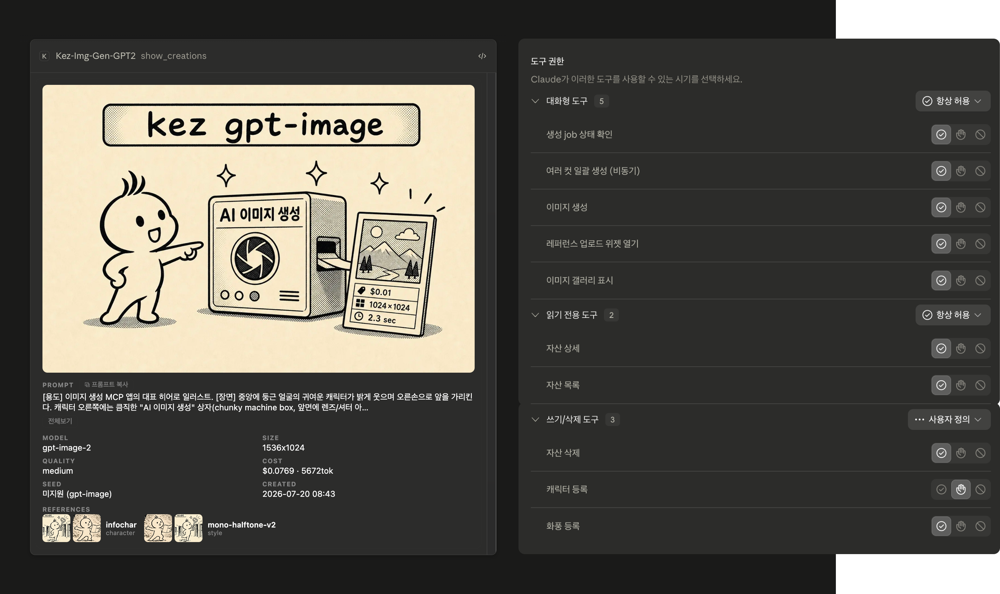
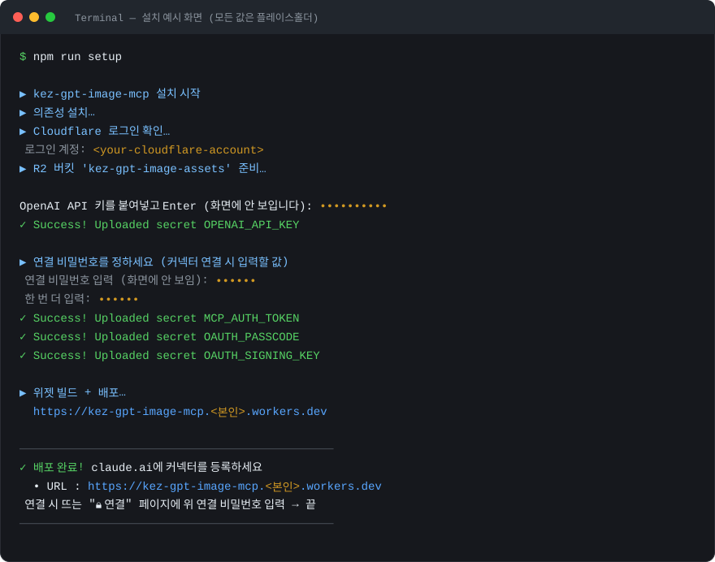
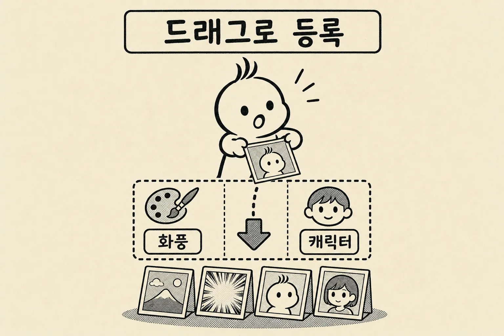
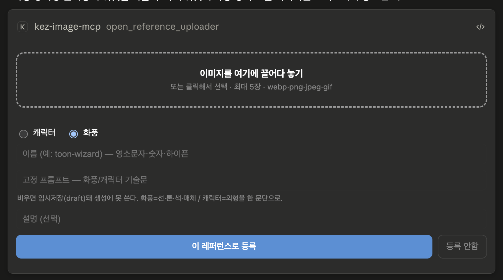

# Kez gpt-image — Claude용 이미지 생성 MCP 서버

<p align="center">
  
</p>

OpenAI **gpt-image**를 Claude(claude.ai · 데스크탑 · 폰)에 붙여, **채팅 안에서** 이미지를 생성하고 화풍·캐릭터를 일관되게 관리하는 MCP 서버입니다. Cloudflare Worker로 **1인 1배포**, Cloudflare는 무료 한도 안에서 사실상 0원(과금은 본인 OpenAI 사용량만).

---

## 뭐가 다른가 — 이 서버만의 장점

단순히 이미지를 뱉는 게 아니라, 결과가 **Claude 채팅 안의 위젯**으로 떠서 한눈에 보이고 관리됩니다.

- 🖼️ **결과 위젯** — 생성된 이미지가 **비용($)·해상도·모델·사용 토큰·전체 프롬프트**까지 담긴 카드로 표시됩니다. 이미지를 클릭하면 확대(라이트박스), 호버하면 다운로드 버튼. 여러 장을 한 번에 뽑으면(인스타툰 등) 상단의 **일괄 저장(ZIP) 버튼**으로 전부 한 파일로 받습니다.
- 🎨 **레퍼런스(화풍·캐릭터) 등록을 채팅 안에서** — 채팅에 뜨는 **끌어놓기 위젯**에 이미지를 드롭하면 곧바로 저장소(R2)에 올라가 앵커로 등록됩니다. 이미지 바이트가 LLM(대화)을 **통과하지 않아** 토큰을 쓰지 않습니다. 등록한 화풍/캐릭터로 **일관된 시리즈**를 생성할 수 있습니다.
- 🧩 **화풍 일관성 게이트** — style을 필수로 두고 등록된 앵커 + 고정 프롬프트를 자동 결합해, 여러 컷을 뽑아도 그림체가 흔들리지 않습니다. (미완성 화풍은 생성 단계에서 막아 "조용한 실패"를 방지)
- ⚡ **배치 생성** — 여러 컷을 한 번의 호출로 큐에 올리고(`generate_batch`), 완성된 컷들을 한 번에 위젯으로 회수(`check_jobs`). 분당 페이싱·자동 재시도·10분 시간초과까지 서버가 알아서 처리.
- 🔐 **보안 내장** — 비공개 R2 + HMAC 서명 URL, **OAuth 연결 비밀번호 게이트(PKCE S256)**, 업로드 전용 저권한 토큰 분리. (claude.ai는 URL만으로 OAuth를 강제하므로, 연결 비밀번호가 익명 토큰 탈취를 막는 실제 보안 경계입니다.)

**제공 도구(claude.ai가 자동 인식):**
`generate_image` · `generate_batch` · `check_jobs` · `show_creations` · `open_reference_uploader` · `register_character` · `register_style` · `list_assets` · `get_asset` · `delete_asset`

---

## 필요한 것

- **Cloudflare 계정**(무료) — 워커·R2 저장소
- **OpenAI API 키** — https://platform.openai.com/api-keys (이미지 사용량만큼 본인 OpenAI에 과금)
- **Node.js 22+**, 터미널

---

## 설치 — 방법 0: Deploy to Cloudflare 버튼 (원클릭, 제일 쉬움)

[](https://deploy.workers.cloudflare.com/?url=https://github.com/HarinJin/kez-gpt-image-mcp)

버튼을 누르면 Cloudflare가 **터미널 없이** 다음을 알아서 처리합니다:
1. 이 저장소를 **본인 GitHub로 복제**
2. `wrangler.toml`을 읽어 **R2 버킷·Durable Objects 자동 생성**
3. **OpenAI 키·인증 토큰·연결 비밀번호**를 입력 폼으로 물어봄 (각 칸에 안내 설명 표시)
4. 워커 **배포** → 배포된 URL 발급

필요한 것: **Cloudflare 계정(무료)** · **OpenAI API 키**. 배포가 끝나면 그 워커 URL을 아래 [claude.ai 커넥터 등록](#claudeai-커넥터-등록)에 넣고, 연결 시 뜨는 비밀번호 페이지에 위에서 정한 **연결 비밀번호**를 입력하면 끝입니다.

> 입력 항목: `OPENAI_API_KEY`(OpenAI 키), `MCP_AUTH_TOKEN`(아무 긴 무작위 문자열 — `openssl rand -hex 32` 결과 권장), `OAUTH_PASSCODE`(본인이 정하는 연결 비밀번호). `OAUTH_SIGNING_KEY`는 선택이며 비우면 자동으로 `MCP_AUTH_TOKEN`을 재사용합니다.
>
> **비워둬도 되는 칸:** `PROTECTED_SLUGS`(고급·잠금 목록, 보통 빈 값) · `Location hint`(R2 지역 자동선택). **처음 R2를 쓰는 계정**이면 폼에서 **R2 활성화**를 한 번 요구할 수 있는데, `Upgrade`/활성화를 누르면 됩니다 — 무료 한도(10GB 등) 안에선 과금 0입니다.

터미널로 직접 하고 싶으면 아래 방법 1~3 중 하나를 쓰세요.

## 설치 — 방법 1: Claude Code 한 프롬프트 (코드가 대신)

이 저장소를 받은 뒤, **클로드 코드에 아래를 그대로 붙여넣으세요.** 나머지는 클로드가 합니다.

```
이 폴더(kez-gpt-image-mcp)를 내 Cloudflare에 배포해줘.
1) node가 22+ 인지 확인하고 npm install.
2) npx wrangler login 하고 어느 계정인지 보여줘.
3) wrangler.toml의 bucket_name 으로 R2 버킷을 만들어줘 (npx wrangler r2 bucket create ...).
4) OPENAI_API_KEY 시크릿에 내 OpenAI 키를 넣어줘 — 나한테 물어보고, 화면·로그에 절대 출력하지 마.
5) openssl rand -hex 32 로 MCP_AUTH_TOKEN 을 만들어 시크릿에 넣어(내부용이라 나한테 안 보여줘도 돼).
6) 연결 비밀번호를 나한테 물어봐서 OAUTH_PASSCODE 시크릿에 넣어줘(커넥터 연결할 때 내가 입력할 값이야). 화면·로그엔 절대 출력하지 마.
7) openssl rand -hex 32 로 OAUTH_SIGNING_KEY 를 만들어 시크릿에 넣어(자동, 나한테 안 보여줘도 돼).
8) npm run build:widget 후 npx wrangler deploy 하고 워커 URL을 알려줘.
끝나면 claude.ai 커넥터에 넣을 URL을 보여주고, 연결 시 뜨는 비밀번호 페이지에 OAUTH_PASSCODE 를 입력하면 된다고 안내해줘.
```

## 설치 — 방법 2: 셋업 스크립트 (터미널 원터치)

```bash
npm run setup
```

로그인 → R2 버킷 → OpenAI 키 입력 → 인증 토큰 자동 생성 → **연결 비밀번호 입력** → 서명 키 자동 생성 → 빌드·배포 까지 차례로 처리하고, 끝에 **커넥터에 넣을 URL**과 연결 방법을 출력합니다.

## 설치 — 방법 3: 수동 (CLI)

```bash
npm install
npx wrangler login
npx wrangler r2 bucket create kez-gpt-image-assets      # wrangler.toml의 bucket_name과 동일하게
npx wrangler secret put OPENAI_API_KEY                  # 본인 OpenAI 키 입력
openssl rand -hex 32 | npx wrangler secret put MCP_AUTH_TOKEN     # 내부용 토큰(자동 생성값)
npx wrangler secret put OAUTH_PASSCODE                  # 연결 비밀번호 — 본인이 정함(커넥터 연결 시 입력할 값)
openssl rand -hex 32 | npx wrangler secret put OAUTH_SIGNING_KEY  # OAuth code 서명 키(별도 랜덤)
npm run deploy                                          # 위젯 빌드 + 배포 → 끝에 워커 URL
```

**설치는 이렇게 진행됩니다** — 아래는 예시 화면입니다(실제 토큰·비밀번호·계정 값은 나오지 않는 플레이스홀더):

<p align="center">
  
</p>

---

## claude.ai 커넥터 등록

claude.ai → **Settings → Connectors → Add custom connector**:

| 필드 | 값 |
|------|-----|
| URL | 배포된 워커 URL (예: `https://kez-gpt-image-mcp.<본인>.workers.dev`) |

**URL만 넣으면 됩니다.** claude.ai 커넥터에는 이제 Bearer 토큰 입력칸이 없고, 대신 **OAuth로 연결**합니다. **연결(Connect)** 을 누르면 워커가 띄우는 **"🔒 연결" 비밀번호 페이지**가 뜨고, 여기에 설치 때 정한 **연결 비밀번호(`OAUTH_PASSCODE`)** 를 입력하면 됩니다 — 도구를 쓸 때마다가 아니라 **연결할 때 한 번만**. 통과하면 도구가 자동 인식됩니다. 대화창의 도구 아이콘에서 이 커넥터를 **ON**.

> 🔐 **왜 비밀번호인가:** claude.ai는 URL만으로 OAuth 핸드셰이크를 강제합니다. 만약 `/authorize`가 아무에게나 인증 code를 내주면, 워커 URL만 아는 사람이 `/token`으로 access_token을 빼내 남의 OpenAI 예산으로 이미지를 뽑을 수 있습니다. 그래서 `/authorize`에서 **연결 비밀번호로 소유자를 먼저 인증**하고, code는 **PKCE(S256)·redirect_uri에 묶인 서명된 단명 토큰**으로만 발급합니다. (`MCP_AUTH_TOKEN`을 커넥터에 직접 붙여넣던 구버전 안내는 폐기 — 현행 claude.ai UI엔 그 입력칸이 없습니다.)

---

## 레퍼런스 등록 — 화풍·캐릭터 (채팅 안에서 드래그)

"이 그림 화풍으로 등록할래"처럼 말하면 채팅 안에 **끌어놓기 위젯**이 뜹니다. 이미지를 드롭 → **화풍/캐릭터** 선택 → 이름·고정 프롬프트 입력 → 등록. 이미지 바이트는 워커로 직접 올라가 **대화(LLM)를 통과하지 않아 토큰을 쓰지 않습니다.** 등록한 화풍/캐릭터로 여러 컷을 뽑아도 그림체가 일관됩니다.

<p align="center">
  
</p>

실제 위젯 화면 (채팅 안에 인라인으로 뜸):



---

## 써보기

- **생성:** "노을 지는 한강을 webtoon 화풍으로 그려줘" → 결과 위젯(비용·해상도·프롬프트) 표시
- **레퍼런스 등록:** "이 그림 화풍으로 등록할래" → 채팅에 뜬 끌어놓기 위젯에 이미지 드롭 → 이름 정하고 등록 → 그 style로 일관 생성
- **배치:** "이 장면 4컷으로 뽑아줘" → 한 번에 큐 적재 → 완성되면 갤러리로 한 번에 표시
- **관리:** "등록된 화풍 목록 보여줘" / "이 결과 다시 띄워줘"

---

## 비용·운영 메모

- **과금:** OpenAI gpt-image 사용량만큼 **본인 OpenAI 계정**에 과금됩니다(컷당 대략 수 센트, 화질·해상도에 따라). Cloudflare(Worker·R2·DO)는 무료 한도 안에서 사실상 0원.
- **R2:** Cloudflare 대시보드에서 R2를 1회 활성화해야 합니다(버킷 생성 포함).
- **Cloudflare Images(선택):** 앵커 다운스케일에 쓰이며, 미활성이면 원본 전송으로 자동 폴백 — 기능 저하 없음.
- **시크릿 안전:** `OPENAI_API_KEY`·`MCP_AUTH_TOKEN`·`OAUTH_PASSCODE`·`OAUTH_SIGNING_KEY`는 `wrangler secret` 으로만 등록되고 **코드·git에 절대 들어가지 않습니다.** (`OAUTH_SIGNING_KEY`는 선택 — 미설정 시 `MCP_AUTH_TOKEN`으로 폴백하지만, 별도 랜덤값 권장.) 유출 대응: `MCP_AUTH_TOKEN`을 회전(재등록+재배포)하면 기존 연결·서명 URL이 전부 무효화되는 kill-switch가 됩니다.
- **갱신:** 코드를 고치면 `npm run deploy` 로 다시 배포(워커는 git push로 자동 반영되지 않습니다).

---

## 개발

```bash
npm run typecheck     # 타입 검사
npm test              # vitest
npm run dev           # 로컬 (.dev.vars 필요 — .dev.vars.example 복사해서 채움)
npm run build:widget  # 위젯(gallery/uploader) 빌드 → src/gallery-html.ts 재생성
```

위젯 원본은 `widget/gallery.js`·`widget/uploader.js` 이고, 수정 후 `npm run build:widget` 으로 인라인 번들을 재생성합니다.
